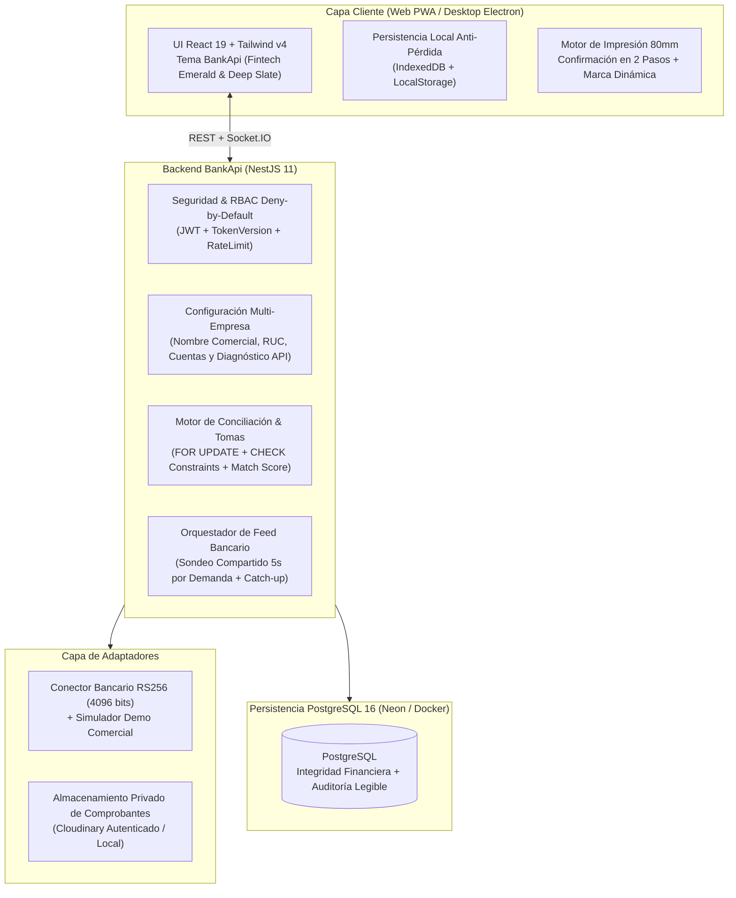

# Plan Maestro de Trabajo y Arquitectura: **BankApi**

> **Estado de Ejecución:** COMPLETADO Y VERIFICADO (Persistido en el repositorio para continuidad entre agentes y sesiones).
> **Repositorio Destino:** `https://github.com/edisonroaa-code/BankApi.git`
> **Directorio de Trabajo:** `C:\Users\Usuario\Desktop\APLICATIVOS\bankApi`

---

## 1. Misión y Propósito del Producto

**BankApi** es un sistema comercial, genérico, universal y llave en mano (*turnkey*) para la **verificación de cobranzas en Caja y Área de Cobranzas**, construido con invariantes de seguridad financiera probadas en producción y **100% independiente de cualquier marca de cliente particular**.

El objetivo comercial de **BankApi** es que, al instalarlo en cualquier empresa compradora, la puesta en marcha se limite únicamente a:
1. **Configurar los datos de la empresa y la API que el banco provea** (o las cuentas bancarias receptoras con API / aprobación manual).
2. **Crear los usuarios de la empresa** (`ADMIN`, `SUPERVISOR`, `CAJERO`, `COBRADOR`).

---

## 2. Componentes Integrados del Sistema

1. **Sistema Principal Full-Stack**:
   - React 19.2 + TypeScript 5.8 + Vite 6.2 (`:48517`) + Tailwind CSS 4.1 + Socket.IO Client 4.8 + PWA + Electron 39.
   - Backend NestJS 11 (`:48300`) + TypeORM 0.3.28 + PostgreSQL 16 (`:48543` en Docker `bankapi_db`) + Passport JWT + Bcrypt + ExcelJS + PDFKit + Cloudinary.
2. **Laboratorio de Conector Bancario (`tools/bank-api-lab/`)**:
   - FastAPI + `httpx` + `PyJWT[crypto]` (`:48880`, `api_atlas.py`, `app.py`), integrado en `tools/bank-api-lab/` como kit de homologación y diagnóstico bancario.

> **Regla Crítica de Secretos:** Jamás incluir archivos `.env`, `.env.local`, `.env.neon`, backups SQL ni llaves privadas reales (`keys/*.pem`) en el repositorio `BankApi`.

---

## 3. Arquitectura y Mejoras del Producto **BankApi**

### Mejoras Clave Implementadas en **BankApi**

1. **Despersonalización Total (*White-Label* / *Marca Propia BankApi*)**:
   - Eliminación del 100% de referencias a marcas o dominios de clientes anteriores en vistas, tickets, reportes, manifiestos e instaladores.
   - Nuevos identificadores de sesión y almacenamiento local: `bankapi_session_v1`, `bankapi_saved_users_v1`, `bankapi_last_user_v1`, `bankapi_company_profile_v1`.
   - Nuevo namespace IPC en Electron: `window.bankapi`.
2. **Nueva Identidad Visual y Paleta de Colores (**BankApi**)**:
   - **Logo Oficial BankApi**: Nuevo isotipo y logotipo (escudo financiero + pulso de verificación bancaria) generado en `public/logo.png`, `public/favicon.png`, `public/icons/icon-192.png`, `public/icons/icon-512.png`, `resources/icon.png` y `resources/splash.png`.
   - **Paleta Fintech Emerald & Deep Slate**: Navegación en `#0b1120` / `slate-950` con acentos corporativos `emerald-600` (`#059669`) y `teal-600` (`#0d9488`).
3. **Configuración Comercial Multi-Empresa y Cuentas Receptoras Genéricas**:
   - **Perfil de Empresa Configurable**: Nombre de la empresa instalada, subtítulo/RUC y pie de ticket configurables desde el panel de Administración y reflejados automáticamente en:
     - Barra de navegación y pantalla de inicio de sesión.
     - Tickets térmicos de 80 mm (`PrintableTicket` y `BankTransferReceipt`).
     - Reportes exportables en PDF y Excel (`ReportsService`).
   - **Cuentas Receptoras Genéricas**: En lugar de acoplar la UI exclusivamente a *"Atlas vs. BNF"*, las etiquetas operativas se parametrizan (`Cuenta con Verificación API` vs `Cuenta de Verificación Manual`, permitiendo mostrar el nombre del banco configurado por la empresa cliente), manteniendo intacta la columna `isAtlasAccount` en PostgreSQL para preservar compatibilidad con las 6 migraciones versionadas y las 383 pruebas del backend.
4. **Panel de Puesta en Marcha y Diagnóstico Bancario en Admin**:
   - Vista integrada en el panel de `ADMIN` para personalizar los datos comerciales de la empresa, verificar el estado del conector bancario (`EN_VIVO`, `EN_ESPERA`, `SIN_CONFIGURAR`, etc.), consultar la guía rápida de variables de la API del banco y administrar los usuarios de la empresa.

---

## 4. Checklist de Fases para Agentes (Estado de Avance)

- [x] **Fase 0: Documentación en Repositorio y Git Local**
  - [x] Crear `IMPLEMENTATION_PLAN.md` en la raíz del repositorio.
  - [x] Crear `AGENTS.md` adaptado a **BankApi** con todas las reglas de seguridad, gobernanza, escalabilidad y pruebas.
  - [x] Inicializar repositorio Git local y remoto `origin` (`https://github.com/edisonroaa-code/BankApi.git`).
- [x] **Fase 1: Clonado Base y Limpieza Estructural**
  - [x] Clonar código fuente limpio del sistema principal (`frontend`, `backend`, `electron`, `scripts`, `public`, `resources`).
  - [x] Clonar código fuente limpio del laboratorio bancario en `tools/bank-api-lab/`.
  - [x] Configurar `.gitignore` unificado para evitar subir secretos, `node_modules`, `.venv`, `uploads` o artefactos de compilación.
- [x] **Fase 2: Rebranding a BankApi, Nuevo Logo y Despersonalización**
  - [x] Generar nuevos recursos gráficos de **BankApi** (`logo.png`, `favicon.png`, `icon-192.png`, `icon-512.png`, `resources/icon.png`, `resources/splash.png`).
  - [x] Actualizar `package.json`, `backend/package.json`, `index.html`, `vite.config.ts`, `index.css`, `render.yaml`, `docker-compose.yml`.
  - [x] Reemplazar identificadores de sesión, namespace IPC (`window.bankapi`) y textos de marca en vistas, componentes, servicios, scripts y Electron.
- [x] **Fase 3: Parametrización Comercial Multi-Empresa**
  - [x] Crear servicio de perfil de empresa (`services/company-profile.ts`) y soporte en backend/reportes para que tickets de 80 mm y reportes PDF/Excel usen el nombre de la empresa configurada (por defecto `"BankApi"`).
  - [x] Generalizar etiquetas de cuentas receptoras en `services/payment-destination.ts` y vistas asociadas.
  - [x] Agregar pestaña **Configuración** en `AdminDashboard.tsx` para configurar la empresa instalada y diagnosticar la conexión bancaria.
- [x] **Fase 4: Verificación Integral, Pruebas, Compilación y Push**
  - [x] Ejecutar `npm run typecheck` (0 errores).
  - [x] Ejecutar suite completa de Backend (`npm --prefix backend test -- --runInBand` — 51 suites / 400 tests aprobados).
  - [x] Ejecutar suites de políticas de Frontend (`npm run test:manual-policy` 104/104, `npm run test:health` 6/6, `npm run test:secrets` 1/1).
  - [x] Compilar producción (`npm --prefix backend run build:prod` y `npm run build`).
  - [x] Verificar con búsqueda automatizada que no existan referencias a marcas anteriores ni secretos en el árbol de Git.
  - [x] Realizar commits estructurados y `git push -u origin main`.
